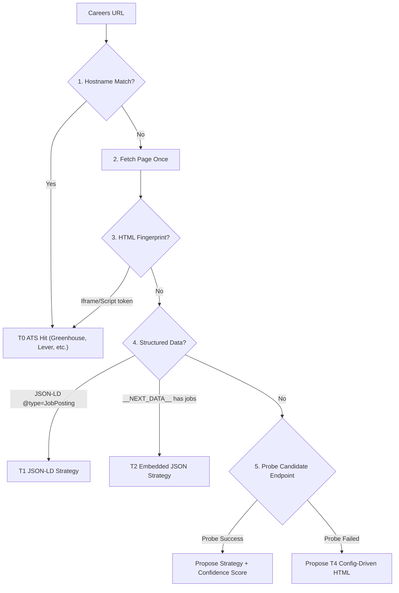
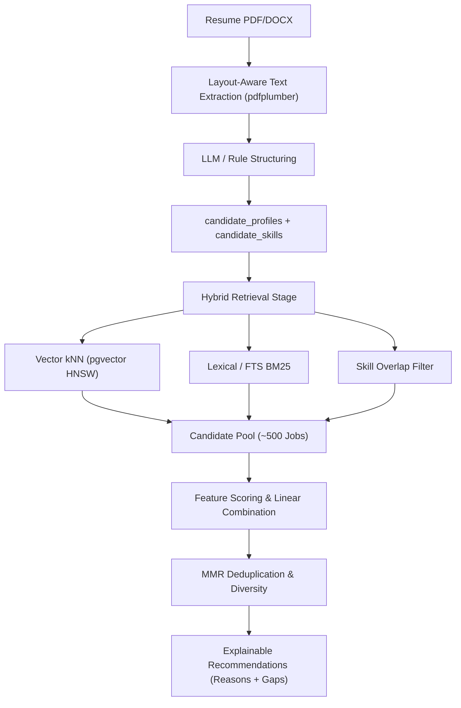

# Job Aggregation & Matching Platform: Step-by-Step Implementation Guide

> **Document Scope**: This guide translates the entire system design specification into an actionable, phase-by-phase engineering implementation manual. It provides concrete module structures, database schemas, validation models, algorithms, code patterns, test specifications, and acceptance criteria for building the platform from scratch to production.

---

## Table of Contents

1. [Architecture Principles & System Boundary Rules](#1-architecture-principles--system-boundary-rules)
2. [Target Repository Layout & Modular Monolith Structure](#2-target-repository-layout--modular-monolith-structure)
3. [Phase 0: Foundations & Project Skeleton (Days 1–3)](#3-phase-0-foundations--project-skeleton-days-13)
4. [Phase 1: One-Source Vertical Slice (The MVP) (Weeks 1–2.5)](#4-phase-1-one-source-vertical-slice-the-mvp-weeks-125)
   - [Step 1.1: Core Database Models & Alembic Migration](#step-11-core-database-models--alembic-migration)
   - [Step 1.2: Canonical Schema & Validation Tiers](#step-12-canonical-schema--validation-tiers)
   - [Step 1.3: Hardened Resilient Fetcher](#step-13-hardened-resilient-fetcher)
   - [Step 1.4: Pure Normalization & Sanitization Pipeline](#step-14-pure-normalization--sanitization-pipeline)
   - [Step 1.5: First ATS Adapter (Greenhouse) with Offline Fixtures](#step-15-first-ats-adapter-greenhouse-with-offline-fixtures)
   - [Step 1.6: Idempotent Upsert, Content Hashing & Version Snapshots](#step-16-idempotent-upsert-content-hashing--version-snapshots)
   - [Step 1.7: Postgres Task Queue (SKIP LOCKED)](#step-17-postgres-task-queue-skip-locked)
   - [Step 1.8: Worker Loop & Scheduler](#step-18-worker-loop--scheduler)
   - [Step 1.9: Complete-Gated Lifecycle Sweep](#step-19-complete-gated-lifecycle-sweep)
   - [Step 1.10: Public & Admin REST APIs](#step-110-public--admin-rest-apis)
   - [Phase 1 Acceptance Gate](#phase-1-acceptance-gate)
5. [Phase 2: Abstraction Proof with Second Source & Anomaly Guards (Weeks 3–4.5)](#5-phase-2-abstraction-proof-with-second-source--anomaly-guards-weeks-345)
   - [Step 2.1: Unified Adapter Contract & Shared Fixture Test Suite](#step-21-unified-adapter-contract--shared-fixture-test-suite)
   - [Step 2.2: Second Source Adapter (JSON-LD / Config-Driven HTML)](#step-22-second-source-adapter-json-ld--config-driven-html)
   - [Step 2.3: Automated Source Detection Ladder (T0–T4)](#step-23-automated-source-detection-ladder-t0t4)
   - [Step 2.4: Run Anomaly Guards & Parse-Failure Quarantine](#step-24-run-anomaly-guards--parse-failure-quarantine)
   - [Step 2.5: Circuit Breaker State Machine](#step-25-circuit-breaker-state-machine)
   - [Phase 2 Acceptance Gate](#phase-2-acceptance-gate)
6. [Phase 3: Scale Out, Deduplication & Production Hardening (Weeks 5–8)](#6-phase-3-scale-out-deduplication--production-hardening-weeks-58)
   - [Step 3.1: Expanding ATS Adapters (Lever, Ashby, SmartRecruiters, Workable, Recruitee)](#step-31-expanding-ats-adapters)
   - [Step 3.2: Declarative HTML Config Engine & Optional Playwright Worker](#step-32-declarative-html-config-engine--optional-playwright-worker)
   - [Step 3.3: Cross-Source Deduplication & Canonical Grouping](#step-33-cross-source-deduplication--canonical-grouping)
   - [Step 3.4: Data Retention & Automated Archival](#step-34-data-retention--automated-archival)
   - [Step 3.5: Offline Reparse Tooling](#step-35-offline-reparse-tooling)
   - [Step 3.6: Observability (Prometheus Metrics & Structured Logging)](#step-36-observability-prometheus-metrics--structured-logging)
   - [Phase 3 Acceptance Gate](#phase-3-acceptance-gate)
7. [Phase 4: Users, Saved Jobs & Application Tracking (Weeks 9–11)](#7-phase-4-users-saved-jobs--application-tracking-weeks-911)
8. [Phase 5: Matching Engine & Semantic Search (Weeks 12–17)](#8-phase-5-matching-engine--semantic-search-weeks-1217)
9. [Detailed Execution Guide for the First 5 Tasks](#9-detailed-execution-guide-for-the-first-5-tasks)
10. [Developer Runbook & CLI Commands](#10-developer-runbook--cli-commands)

---

## 1. Architecture Principles & System Boundary Rules

Before writing code, enforce these architectural invariants:

1. **Source-Type-First Ingestion**: Never build a generic web crawler. Categorize sources by Applicant Tracking System (Greenhouse, Lever, Ashby, SmartRecruiters, Workable, Recruitee, Workday). Use structured JSON APIs (T0) first; fallback to HTML/Playwright (T4/T5) only when no API exists.
2. **Strategy Ladder Ordering**:
   - `T0`: Official/Public ATS JSON API or Feed (Highest stability, lowest cost)
   - `T1`: Sitemap + `schema.org/JobPosting` JSON-LD
   - `T2`: Embedded JSON in HTML (`__NEXT_DATA__`, `window.__INITIAL_STATE__`)
   - `T3`: Internal XHR endpoint discovered in network tab (`strategy_risk = 'elevated'`)
   - `T4`: Declarative config-driven CSS selector HTML parsing
   - `T5`: Playwright rendered DOM/intercepted XHR (Last resort, 10–50x cost)
3. **Modular Monolith**: One codebase, one Docker image, three process roles:
   - `api`: Flask WSGI serving public read and protected admin endpoints.
   - `worker`: Background workers claiming tasks via Postgres `FOR UPDATE SKIP LOCKED`.
   - `scheduler`: Lightweight cron tick enqueuing due discovery and sweep tasks.
4. **Postgres-Backed Task Queue**: Do not introduce Redis, Celery, or RabbitMQ for MVP. Leverage transactional enqueuing in PostgreSQL.
5. **Immutable Raw Store + Pure `parse()`**: Every HTTP payload is stored unparsed in `raw_documents`. Adapters implement pure deterministic `parse(raw) -> ParsedJob` with zero network I/O.
6. **Conservative Lifecycle Management**: Never mark a job `closed` because of a single missing crawl. Require $N$ consecutive complete crawls (e.g., $N=3$) and an elapsed time floor (e.g., $\ge 48$ hours). Never close jobs if a crawl is incomplete, failed, or quarantined.
7. **Deduplication: Group, Don't Delete**: Link duplicate postings to a `canonical_job_id`. Never delete records based on heuristic matching.
8. **Dependency Rule**:
   - `app.api` may depend on `app.models`, `app.schemas`, `app.core`.
   - `app.api` must **never** import `app.ingestion`.
   - `app.ingestion` may depend on `app.etl`, `app.models`, `app.core`.
   - Read paths stay 100% operational even if the entire ingestion pipeline is down.

---

## 2. Target Repository Layout & Modular Monolith Structure

Reorganize the repository into the standard modular layout:

```
job_search/
├── app/
│   ├── __init__.py
│   ├── core/                      # Shared infrastructure & utilities
│   │   ├── __init__.py
│   │   ├── config.py              # Pydantic BaseSettings / env configs
│   │   ├── database.py            # SQLAlchemy 2.0 engine & sessionmaker
│   │   ├── logging.py             # Structlog configuration (JSON/console)
│   │   └── errors.py              # Base exceptions & RFC 7807 error models
│   ├── models/                    # SQLAlchemy declarative ORM models
│   │   ├── __init__.py
│   │   ├── company.py             # Company model
│   │   ├── source.py              # Source model (config, schedule, circuit)
│   │   ├── crawl_run.py           # CrawlRun execution audit model
│   │   ├── raw_document.py        # RawDocument immutable payload store
│   │   ├── job.py                 # Job & JobVersion models + FTS vectors
│   │   ├── task.py                # Task queue model (SKIP LOCKED)
│   │   └── parse_failure.py       # Quarantined parse errors
│   ├── schemas/                   # Pydantic validation & API serialization schemas
│   │   ├── __init__.py
│   │   ├── canonical.py           # CanonicalJob, JobRef, RawJob payloads
│   │   ├── api_job.py             # API response & query filter schemas
│   │   ├── source.py              # Admin source registration schemas
│   │   └── detection.py           # Detection evidence & candidate schemas
│   ├── registry/                  # Source registry management services
│   │   ├── __init__.py
│   │   └── service.py             # Register, update, circuit reset logic
│   ├── detection/                 # Source detection engine
│   │   ├── __init__.py
│   │   ├── detector.py            # Main detector combining heuristics
│   │   ├── rules.py               # Hostname patterns & regex rules
│   │   └── probes.py              # Lightweight endpoint health probes
│   ├── ingestion/                 # Crawling, scheduling, worker loop
│   │   ├── __init__.py
│   │   ├── fetcher/
│   │   │   ├── __init__.py
│   │   │   ├── client.py          # Requests/HTTP client with timeout, UA
│   │   │   ├── rate_limiter.py    # Token bucket per-domain limiter
│   │   │   ├── robots.py          # Cached robots.txt parser
│   │   │   ├── ssrf.py            # Private IP & loopback IP validator
│   │   │   └── breaker.py         # Source-level circuit breaker
│   │   ├── adapters/
│   │   │   ├── __init__.py
│   │   │   ├── base.py            # SourceAdapter abstract interface
│   │   │   ├── greenhouse.py      # Greenhouse API adapter
│   │   │   ├── lever.py           # Lever API adapter
│   │   │   ├── jsonld.py          # Schema.org JobPosting adapter
│   │   │   └── html_config.py     # Declarative CSS selector adapter
│   │   ├── scheduler.py           # Periodic scheduler enqueuing due runs
│   │   └── worker.py              # Worker loop consuming task queue
│   ├── etl/                       # Parsing, normalizers, upsert, lifecycle
│   │   ├── __init__.py
│   │   ├── normalizers/
│   │   │   ├── __init__.py
│   │   │   ├── text.py            # NFKC unicode, whitespace, unescape
│   │   │   ├── html.py            # Allowlist sanitization (nh3/bleach)
│   │   │   ├── location.py        # Location struct & country code parsing
│   │   │   ├── employment.py      # Full-time, part-time, contract mapping
│   │   │   ├── workplace.py       # Onsite, hybrid, remote detection
│   │   │   ├── seniority.py       # Senior, lead, intern classification
│   │   │   ├── experience.py      # Min/max years regex extraction
│   │   │   └── salary.py          # Structured currency/period parser
│   │   ├── fingerprint.py         # Content hash & dedupe key calculation
│   │   ├── validate.py            # Hard & soft validation rules
│   │   ├── upsert.py              # Idempotent upsert & version snapshotting
│   │   └── lifecycle.py           # Complete-gated lifecycle sweep
│   └── api/                       # Flask application & blueprints
│       ├── __init__.py
│       ├── app.py                 # Flask factory (`create_app`)
│       ├── middleware.py          # Request ID, error handler, rate limit
│       ├── v1/
│       │   ├── __init__.py
│       │   ├── jobs.py            # Public GET /api/v1/jobs, /jobs/{id}
│       │   ├── companies.py       # Public GET /api/v1/companies
│       │   └── facets.py          # Public GET /api/v1/facets
│       └── admin/
│           ├── __init__.py
│           ├── sources.py         # POST /admin/v1/sources, detection
│           ├── runs.py            # GET /admin/v1/crawl-runs
│           └── tasks.py           # Dead-letter queue inspection & retries
├── migrations/                    # Alembic migration environment
│   ├── env.py
│   ├── script.py.mako
│   └── versions/
├── tests/
│   ├── conftest.py
│   ├── unit/                      # Fast in-memory unit tests
│   │   ├── test_normalizers.py
│   │   ├── test_fingerprint.py
│   │   ├── test_lifecycle.py
│   │   └── test_ssrf.py
│   ├── contract/                  # Shared adapter contract test suite
│   │   └── test_adapter_contract.py
│   ├── integration/               # Pipeline tests against PostgreSQL
│   │   ├── test_fetcher.py
│   │   ├── test_upsert_idempotency.py
│   │   ├── test_task_queue.py
│   │   └── test_api_endpoints.py
│   └── fixtures/                  # Real recorded API/HTML responses
│       ├── greenhouse/
│       │   └── 2026-10/sample_board.json
│       └── lever/
│           └── 2026-10/sample_postings.json
├── docker/
│   ├── Dockerfile
│   └── entrypoint.sh
├── docker-compose.yml
├── pyproject.toml
├── alembic.ini
└── README.md
```

---

## 3. Phase 0: Foundations & Project Skeleton (Days 1–3)

### Goal
Establish a running Docker Compose environment, unified dependencies, Alembic migration framework, structured JSON logging, and a healthy Flask API with `/healthz` and `/readyz`.

### Step 0.1: Project Dependencies & Setup
Create `pyproject.toml` (or standard `requirements.txt`) with pinned versions:
```toml
[project]
name = "jobhub"
version = "0.1.0"
dependencies = [
    "flask>=3.0.0",
    "gunicorn>=21.2.0",
    "sqlalchemy>=2.0.25",
    "psycopg2-binary>=2.9.9",
    "alembic>=1.13.1",
    "pydantic>=2.6.0",
    "pydantic-settings>=2.1.0",
    "requests>=2.31.0",
    "urllib3>=2.2.0",
    "beautifulsoup4>=4.12.3",
    "nh3>=0.2.15",               # Fast, safe HTML sanitizer
    "structlog>=24.1.0",
    "python-dotenv>=1.0.1",
    "flask-limiter>=3.5.0",
    "flask-cors>=4.0.0",
]

[project.optional-dependencies]
dev = [
    "pytest>=8.0.0",
    "pytest-mock>=3.12.0",
    "requests-mock>=1.11.0",
    "freezegun>=1.4.0",
    "import-linter>=2.0",
    "ruff>=0.2.2",
]
```

### Step 0.2: Core Infrastructure Modules
1. **Config (`app/core/config.py`)**:
   Implement a `Settings` class using `pydantic_settings.BaseSettings`:
   - `DATABASE_URL`: Connection string (`postgresql://postgres:postgres@db:5432/jobhub`)
   - `ADMIN_API_KEY`: Secret string required for `/admin/*` routes.
   - `USER_AGENT`: Descriptive crawler identity (`JobDiscoveryBot/1.0 (+https://example.com/bot; contact@example.com)`).
   - `DEFAULT_CRAWL_INTERVAL_HOURS`: Default 6 hours.
   - `RATE_LIMIT_PER_DOMAIN_RPS`: Default 1.0.
   - `MAX_PAYLOAD_BYTES`: Default 5 MB.
2. **Database Engine & Session (`app/core/database.py`)**:
   - Create SQLAlchemy 2.0 `engine` with `pool_size=10, max_overflow=20, pool_pre_ping=True`.
   - Setup `sessionmaker(autocommit=False, autoflush=False, bind=engine)`.
   - Provide context manager `get_db_session()` that handles commit on success and rollback on exception.
3. **Structured Logging (`app/core/logging.py`)**:
   - Configure `structlog` to output JSON lines with standard keys: `timestamp`, `level`, `event`, `request_id`, `source_id`, `task_id`, `crawl_run_id`.
4. **Error Envelope (`app/core/errors.py`)**:
   - Standard RFC 7807 error format:
     ```json
     {
       "error": {
         "code": "invalid_parameter",
         "message": "Human readable message",
         "details": [],
         "request_id": "req_abc123"
       }
     }
     ```

### Step 0.3: Docker Compose Services
Create `docker-compose.yml` supporting the three process roles from a single image:
```yaml
version: '3.8'

services:
  db:
    image: postgres:16-alpine
    environment:
      POSTGRES_DB: jobhub
      POSTGRES_USER: postgres
      POSTGRES_PASSWORD: password
    ports:
      - "5432:5432"
    volumes:
      - postgres_data:/var/lib/postgresql/data
    healthcheck:
      test: ["CMD-SHELL", "pg_isready -U postgres -d jobhub"]
      interval: 5s
      timeout: 5s
      retries: 5

  api:
    build:
      context: .
      dockerfile: docker/Dockerfile
    command: gunicorn --bind 0.0.0.0:8000 --workers 4 "app.api.app:create_app()"
    ports:
      - "8000:8000"
    environment:
      - DATABASE_URL=postgresql://postgres:password@db:5432/jobhub
      - ADMIN_API_KEY=dev-secret-key
    depends_on:
      db:
        condition: service_healthy

  worker:
    build:
      context: .
      dockerfile: docker/Dockerfile
    command: python -m app.ingestion.worker
    environment:
      - DATABASE_URL=postgresql://postgres:password@db:5432/jobhub
    depends_on:
      db:
        condition: service_healthy

  scheduler:
    build:
      context: .
      dockerfile: docker/Dockerfile
    command: python -m app.ingestion.scheduler
    environment:
      - DATABASE_URL=postgresql://postgres:password@db:5432/jobhub
    depends_on:
      db:
        condition: service_healthy

volumes:
  postgres_data:
```

### Step 0.4: Health Endpoints & Alembic Initialization
1. In `app/api/app.py`, implement `create_app()` registering `/healthz` (liveness) and `/readyz` (readiness, runs `SELECT 1` against PostgreSQL).
2. Initialize Alembic:
   ```bash
   alembic init migrations
   ```
3. Configure `migrations/env.py` to import `Base.metadata` from `app.models`.

### Phase 0 Acceptance Criteria
- [ ] `docker compose up -d` boots `db`, `api`, `worker`, `scheduler` with no crash loops.
- [ ] `GET http://localhost:8000/readyz` returns HTTP 200 `{"status": "ready"}`.
- [ ] `alembic upgrade head` runs cleanly with zero warnings.
- [ ] `pytest tests/` runs and exits code 0 in CI.

---

## 4. Phase 1: One-Source Vertical Slice (The MVP) (Weeks 1–2.5)

### Goal
Implement the complete vertical pipeline for **one source** (Greenhouse boards JSON API):
`Source Registration` $\to$ `Scheduled Discovery` $\to$ `Resilient Fetch` $\to$ `Immutable Raw Storage` $\to$ `Pure Parse & Normalization` $\to$ `Idempotent Upsert` $\to$ `Snapshot Versioning` $\to$ `Complete-Gated Lifecycle Sweep` $\to$ `Public Keyset Search API`.

```mermaid
flowchart LR
    A["Scheduler"] -->|Enqueue DISCOVER| B["Postgres Queue (tasks)"]
    B -->|Claim SKIP LOCKED| C["Worker"]
    C -->|Fetcher HTTP GET| D["Greenhouse API"]
    D -->|Store Payload| E[("raw_documents")]
    E -->|Pure parse()| F["Adapter"]
    F -->|Normalize & Validate| G["ETL Pipeline"]
    G -->|Upsert & Version| H[("jobs & job_versions")]
    G -->|Lifecycle Sweep| I["Closed/Missing State"]
    H -->|Query Keyset| J["Flask Public API"]
```

---

### Step 1.1: Core Database Models & Alembic Migration
Create the 8 core tables with exact types, constraints, and partial indexes in `app/models/`:

#### 1. `companies` (`app/models/company.py`)
```sql
CREATE TABLE companies (
  id BIGSERIAL PRIMARY KEY,
  name TEXT NOT NULL,
  slug TEXT UNIQUE NOT NULL,
  website TEXT,
  created_at TIMESTAMPTZ NOT NULL DEFAULT NOW()
);
```

#### 2. `sources` (`app/models/source.py`)
```sql
CREATE TABLE sources (
  id BIGSERIAL PRIMARY KEY,
  company_id BIGINT NOT NULL REFERENCES companies(id) ON DELETE CASCADE,
  name TEXT,
  careers_url TEXT NOT NULL,
  adapter_id TEXT NOT NULL,              -- 'greenhouse', 'lever', etc.
  config JSONB NOT NULL DEFAULT '{}',    -- {"board_token": "stripe"}
  detection JSONB,                      -- evidence, confidence score
  enabled BOOLEAN NOT NULL DEFAULT TRUE,
  crawl_interval INTERVAL NOT NULL DEFAULT '6 hours',
  next_crawl_at TIMESTAMPTZ,
  last_success_at TIMESTAMPTZ,
  consecutive_failures INT NOT NULL DEFAULT 0,
  circuit_state TEXT NOT NULL DEFAULT 'closed', -- 'closed' | 'open' | 'half_open'
  circuit_until TIMESTAMPTZ,
  strategy_risk TEXT NOT NULL DEFAULT 'normal', -- 'normal' | 'elevated'
  created_at TIMESTAMPTZ NOT NULL DEFAULT NOW()
);
CREATE INDEX idx_sources_due ON sources (next_crawl_at) WHERE enabled = true AND circuit_state != 'open';
```

#### 3. `crawl_runs` (`app/models/crawl_run.py`)
```sql
CREATE TABLE crawl_runs (
  id BIGSERIAL PRIMARY KEY,
  source_id BIGINT NOT NULL REFERENCES sources(id) ON DELETE CASCADE,
  started_at TIMESTAMPTZ NOT NULL DEFAULT NOW(),
  finished_at TIMESTAMPTZ,
  status TEXT NOT NULL,                  -- 'running' | 'succeeded' | 'partial' | 'failed' | 'quarantined'
  is_complete BOOLEAN NOT NULL DEFAULT FALSE,
  refs_found INT NOT NULL DEFAULT 0,
  jobs_new INT NOT NULL DEFAULT 0,
  jobs_updated INT NOT NULL DEFAULT 0,
  jobs_unchanged INT NOT NULL DEFAULT 0,
  jobs_closed INT NOT NULL DEFAULT 0,
  parse_failures INT NOT NULL DEFAULT 0,
  http_errors INT NOT NULL DEFAULT 0,
  adapter_version TEXT NOT NULL,
  error TEXT,
  stats JSONB
);
CREATE INDEX idx_crawl_runs_source_started ON crawl_runs(source_id, started_at DESC);
```

#### 4. `raw_documents` (`app/models/raw_document.py`)
```sql
CREATE TABLE raw_documents (
  id BIGSERIAL PRIMARY KEY,
  crawl_run_id BIGINT REFERENCES crawl_runs(id) ON DELETE SET NULL,
  source_id BIGINT NOT NULL REFERENCES sources(id) ON DELETE CASCADE,
  url TEXT NOT NULL,
  http_status INT NOT NULL,
  content_type TEXT,
  body_compressed BYTEA NOT NULL,        -- gzip or zstd compressed payload
  body_sha256 CHAR(64) NOT NULL,
  fetched_at TIMESTAMPTZ NOT NULL DEFAULT NOW(),
  kind TEXT NOT NULL                     -- 'listing' | 'detail' | 'api'
);
CREATE INDEX idx_raw_docs_sha ON raw_documents(body_sha256);
```

#### 5. `jobs` (`app/models/job.py`)
```sql
CREATE TABLE jobs (
  id BIGSERIAL PRIMARY KEY,
  source_id BIGINT NOT NULL REFERENCES sources(id) ON DELETE CASCADE,
  company_id BIGINT NOT NULL REFERENCES companies(id) ON DELETE CASCADE,
  external_id TEXT NOT NULL,
  title TEXT NOT NULL,
  title_normalized TEXT NOT NULL,
  description_html TEXT,
  description_text TEXT,
  department TEXT,
  employment_type TEXT,                  -- 'full_time' | 'part_time' | 'contract' | 'intern' | 'other' | 'unknown'
  workplace_type TEXT,                   -- 'onsite' | 'hybrid' | 'remote' | 'unknown'
  seniority TEXT,                        -- 'intern' | 'junior' | 'mid' | 'senior' | 'staff' | 'principal' | 'unknown'
  experience_min_years SMALLINT,
  experience_max_years SMALLINT,
  locations JSONB,                       -- [{"raw": "...", "city": "...", "country_code": "US", "is_remote": false}]
  country_codes TEXT[],
  salary_min NUMERIC,
  salary_max NUMERIC,
  salary_currency CHAR(3),
  salary_period TEXT,
  apply_url TEXT NOT NULL,
  canonical_url TEXT,
  posted_at TIMESTAMPTZ,
  source_updated_at TIMESTAMPTZ,
  first_seen_at TIMESTAMPTZ NOT NULL DEFAULT NOW(),
  last_seen_at TIMESTAMPTZ NOT NULL DEFAULT NOW(),
  last_changed_at TIMESTAMPTZ NOT NULL DEFAULT NOW(),
  closed_at TIMESTAMPTZ,
  status TEXT NOT NULL DEFAULT 'active', -- 'active' | 'missing' | 'closed' | 'expired' | 'archived'
  missed_crawl_count SMALLINT NOT NULL DEFAULT 0,
  content_hash CHAR(64) NOT NULL,
  dedupe_key TEXT,
  canonical_job_id BIGINT REFERENCES jobs(id) ON DELETE SET NULL,
  quality_score REAL NOT NULL DEFAULT 1.0,
  extraction_method TEXT NOT NULL,
  parser_version TEXT NOT NULL,
  raw_document_id BIGINT REFERENCES raw_documents(id),
  extra JSONB DEFAULT '{}',
  search_vector TSVECTOR,
  CONSTRAINT uq_source_external_id UNIQUE (source_id, external_id)
);

-- Partial index for active listings & keyset pagination
CREATE INDEX idx_jobs_active_listing ON jobs (posted_at DESC NULLS LAST, id DESC) WHERE status = 'active';
-- GIN Indexes for Search & Filtering
CREATE INDEX idx_jobs_search_vector ON jobs USING GIN (search_vector);
CREATE INDEX idx_jobs_country_codes ON jobs USING GIN (country_codes);
CREATE INDEX idx_jobs_company_status ON jobs (company_id, status);
CREATE INDEX idx_jobs_dedupe_key ON jobs (dedupe_key);
CREATE INDEX idx_jobs_lifecycle_sweep ON jobs (source_id, status);
```

#### 6. `job_versions` (`app/models/job.py`)
```sql
CREATE TABLE job_versions (
  id BIGSERIAL PRIMARY KEY,
  job_id BIGINT NOT NULL REFERENCES jobs(id) ON DELETE CASCADE,
  version INT NOT NULL,
  content_hash CHAR(64) NOT NULL,
  snapshot JSONB NOT NULL,               -- Full canonical job snapshot
  changed_fields TEXT[],
  created_at TIMESTAMPTZ NOT NULL DEFAULT NOW(),
  CONSTRAINT uq_job_version UNIQUE (job_id, version)
);
```

#### 7. `tasks` (`app/models/task.py`)
```sql
CREATE TABLE tasks (
  id BIGSERIAL PRIMARY KEY,
  type TEXT NOT NULL,                    -- 'DISCOVER' | 'FETCH_DETAIL' | 'REPARSE' | 'SWEEP'
  source_id BIGINT REFERENCES sources(id) ON DELETE CASCADE,
  payload JSONB NOT NULL DEFAULT '{}',
  status TEXT NOT NULL DEFAULT 'pending',-- 'pending' | 'running' | 'done' | 'failed' | 'dead'
  run_after TIMESTAMPTZ NOT NULL DEFAULT NOW(),
  attempts INT NOT NULL DEFAULT 0,
  max_attempts INT NOT NULL DEFAULT 5,
  locked_by TEXT,
  locked_at TIMESTAMPTZ,
  dedupe_key TEXT,
  last_error TEXT,
  created_at TIMESTAMPTZ NOT NULL DEFAULT NOW(),
  finished_at TIMESTAMPTZ
);
CREATE INDEX idx_tasks_queue ON tasks (run_after, id) WHERE status = 'pending';
CREATE UNIQUE INDEX uq_task_pending_dedupe ON tasks (dedupe_key) WHERE status IN ('pending', 'running');
```

#### 8. `parse_failures` (`app/models/parse_failure.py`)
```sql
CREATE TABLE parse_failures (
  id BIGSERIAL PRIMARY KEY,
  source_id BIGINT NOT NULL REFERENCES sources(id) ON DELETE CASCADE,
  raw_document_id BIGINT REFERENCES raw_documents(id) ON DELETE SET NULL,
  external_id TEXT,
  reason TEXT NOT NULL,
  details JSONB,
  created_at TIMESTAMPTZ NOT NULL DEFAULT NOW()
);
```

---

### Step 1.2: Canonical Schema & Validation Tiers
In `app/schemas/canonical.py`, define the unified data model using Pydantic V2:

```python
from datetime import datetime
from decimal import Decimal
from enum import Enum
from typing import Any, Dict, List, Optional
from pydantic import BaseModel, Field, HttpUrl, field_validator

class EmploymentType(str, Enum):
    FULL_TIME = "full_time"
    PART_TIME = "part_time"
    CONTRACT = "contract"
    INTERN = "intern"
    TEMPORARY = "temporary"
    OTHER = "other"
    UNKNOWN = "unknown"

class WorkplaceType(str, Enum):
    ONSITE = "onsite"
    HYBRID = "hybrid"
    REMOTE = "remote"
    UNKNOWN = "unknown"

class SeniorityLevel(str, Enum):
    INTERN = "intern"
    JUNIOR = "junior"
    MID = "mid"
    SENIOR = "senior"
    STAFF = "staff"
    PRINCIPAL = "principal"
    MANAGER = "manager"
    DIRECTOR = "director"
    EXECUTIVE = "executive"
    UNKNOWN = "unknown"

class LocationItem(BaseModel):
    raw: str
    city: Optional[str] = None
    region: Optional[str] = None
    country_code: Optional[str] = None  # ISO 3166-1 alpha-2 (e.g. "US", "IN")
    is_remote: bool = False

class JobRef(BaseModel):
    external_id: str
    url: str
    title: Optional[str] = None
    location_raw: Optional[str] = None
    source_updated_at: Optional[datetime] = None
    listing_hash: Optional[str] = None

class RawJob(BaseModel):
    ref: JobRef
    raw_payload: Dict[str, Any]
    raw_document_id: Optional[int] = None

class ParsedJob(BaseModel):
    external_id: str
    title: str
    description_html: str
    description_text: str
    apply_url: str
    canonical_url: Optional[str] = None
    department: Optional[str] = None
    employment_type: EmploymentType = EmploymentType.UNKNOWN
    workplace_type: WorkplaceType = WorkplaceType.UNKNOWN
    seniority: SeniorityLevel = SeniorityLevel.UNKNOWN
    experience_min_years: Optional[int] = None
    experience_max_years: Optional[int] = None
    locations: List[LocationItem] = Field(default_factory=list)
    country_codes: List[str] = Field(default_factory=list)
    salary_min: Optional[Decimal] = None
    salary_max: Optional[Decimal] = None
    salary_currency: Optional[str] = None
    salary_period: Optional[str] = None
    posted_at: Optional[datetime] = None
    source_updated_at: Optional[datetime] = None
    extra: Dict[str, Any] = Field(default_factory=dict)

    # Hard validation checks
    @field_validator("title")
    def validate_title_length(cls, v: str) -> str:
        clean = v.strip()
        if not (3 <= len(clean) <= 300):
            raise ValueError(f"Title length {len(clean)} out of allowed range [3, 300]")
        return clean

    @field_validator("apply_url")
    def validate_apply_url(cls, v: str) -> str:
        if not (v.startswith("http://") or v.startswith("https://")):
            raise ValueError("apply_url must be an absolute HTTP/HTTPS URL")
        return v
```

#### Validation Tiers Rule Implementation (`app/etl/validate.py`):
- **Hard Rejection**: If `external_id` or `title` is missing, `apply_url` is invalid, or both `description_text` and `description_html` are empty. The job is rejected and routed to `parse_failures`.
- **Soft Penalty**: If location is missing, posted date is null, or description is under 100 characters. Accept the job, but penalize `quality_score` (e.g., $1.0 - 0.2 \text{ per missing soft attribute}$).

---

2### Step 1.3: Hardened Resilient Fetcher
Implement `app/ingestion/fetcher/client.py` and supporting modules:

1. **SSRF Guard (`app/ingestion/fetcher/ssrf.py`)**:
   Resolve the hostname before connection. If the IP address falls into private, loopback, or link-local CIDR blocks (`127.0.0.0/8`, `10.0.0.0/8`, `172.16.0.0/12`, `192.168.0.0/16`, `169.254.0.0/16`, `::1`), raise `SSRFSecurityException`.
2. **Token Bucket Rate Limiter (`app/ingestion/fetcher/rate_limiter.py`)**:
   In-process thread-safe token bucket keyed by domain. Enforce minimum delay of 1.0 second per domain and max concurrency of 1–2 requests per domain.
3. **Robots.txt Parser (`app/ingestion/fetcher/robots.py`)**:
   Fetch `robots.txt` once per domain, parse with `urllib.robotparser.RobotFileParser`, and cache for 24 hours. Refuse request if disallowed.
4. **Resilience & Retry Policies**:
   - Timeouts: 5.0s connect timeout, 20.0s read timeout.
   - Max payload: 5 MB cap (`Stream=True`, abort if `Content-Length > 5MB` or bytes read exceed cap).
   - Retry logic: Exponential backoff with jitter on HTTP 429, 500, 502, 503, 504 and network timeouts. Respect `Retry-After` header. Never retry 400, 401, 403, 404.
5. **Conditional Requests**:
   Support `If-None-Match` (ETag) and `If-Modified-Since`. On HTTP 304, mark crawl as unchanged and exit early.
6. **Raw Document Recording**:
   Compress payload using `gzip.compress()` and compute `sha256 = hashlib.sha256(raw_bytes).hexdigest()`. Persist into `raw_documents` table within the same transaction.

---

### Step 1.4: Pure Normalization & Sanitization Pipeline
Build pure, deterministic functions in `app/etl/normalizers/`:

- **HTML Sanitizer (`app/etl/normalizers/html.py`)**:
  Use `nh3` (or `bleach`) with a strict allowlist of tags (`p`, `br`, `b`, `i`, `strong`, `em`, `ul`, `ol`, `li`, `h1`, `h2`, `h3`, `h4`, `a`).
  Strip all `<script>`, `<style>`, `<iframe>`, and event handler attributes (`onclick`, etc.). Force `rel="nofollow noopener"` on all `<a>` links.
- **Text Normalizer (`app/etl/normalizers/text.py`)**:
  Run `unicodedata.normalize('NFKC', text)`, unescape HTML entities (`html.unescape`), collapse multiple whitespace/newlines (`\s+` $\to$ single space), and strip tracking query parameters (`utm_*`, `ref`, `source`) from URLs.
- **Location Normalizer (`app/etl/normalizers/location.py`)**:
  Parse strings like `"Bengaluru, Karnataka, India"` or `"New York, NY (Remote)"`. Extract `is_remote = True` if keyword matches `"remote"` or `"virtual"`. Map country names/aliases to ISO 3166-1 alpha-2 codes (`"India"` $\to$ `"IN"`, `"USA"` $\to$ `"US"`).
- **Employment & Workplace Types (`app/etl/normalizers/employment.py`, `workplace.py`)**:
  Map ATS raw values (e.g. `"full_time"`, `"Permanent"`, `"Contractor"`) to `EmploymentType`. Search title and description for keywords (`"remote"`, `"hybrid"`, `"in-office"`).
- **Seniority & Experience Extractor (`app/etl/normalizers/seniority.py`, `experience.py`)**:
  - Classify seniority based on regex word boundaries on `title`: `\b(intern|junior|jr|mid|senior|sr|lead|staff|principal|director|vp)\b`.
  - Extract experience years using regex: `(?:(\d+)\s*(?:-|to)\s*)?(\d+)\+?\s*years?(?:\s+of)?\s+experience`.

---

### Step 1.5: First ATS Adapter (Greenhouse) with Offline Fixtures
Implement `app/ingestion/adapters/base.py` and `greenhouse.py`:

```python
from abc import ABC, abstractmethod
from typing import Any, Dict, List, Optional
from app.schemas.canonical import JobRef, ParsedJob, RawJob

class SourceAdapter(ABC):
    adapter_id: str
    version: str = "1.0.0"
    detail_included: bool = True  # Greenhouse list endpoint includes full descriptions

    @classmethod
    @abstractmethod
    def detect(cls, html_content: str, headers: Dict[str, str]) -> Optional[Dict[str, Any]]:
        """Static fingerprint check returning confidence and proposed config."""
        pass

    @abstractmethod
    def probe(self, config: Dict[str, Any], fetcher: Any) -> bool:
        """Lightweight health check against the vendor endpoint."""
        pass

    @abstractmethod
    def discover(self, config: Dict[str, Any], fetcher: Any) -> List[RawJob]:
        """Discovers jobs. For detail_included=True, returns populated RawJob items."""
        pass

    @abstractmethod
    def parse(self, raw: RawJob) -> ParsedJob:
        """PURE function: transforms raw payload into canonical ParsedJob."""
        pass
```

#### Greenhouse Adapter Specifics (`app/ingestion/adapters/greenhouse.py`):
- Endpoint: `https://boards-api.greenhouse.io/v1/boards/{board_token}/jobs?content=true`
- `probe()`: Issues GET against `https://boards-api.greenhouse.io/v1/boards/{board_token}`. Returns `True` if HTTP 200.
- `discover()`: Fetches the JSON payload, records payload to `raw_documents`, extracts jobs array, and returns `List[RawJob]`. Sets `complete = True`.
- `parse()`: Pure transformation:
  - `external_id = str(job["id"])`
  - `title = job["title"]`
  - `description_html = job.get("content", "")`
  - `apply_url = job["absolute_url"]`
  - Pass fields through normalizers.

---

### Step 1.6: Idempotent Upsert, Content Hashing & Version Snapshots
In `app/etl/fingerprint.py` and `app/etl/upsert.py`:

1. **Meaningful Fields Content Hash**:
   Compute `content_hash` over stable semantic fields only (exclude timestamps, view counters, dynamic CSRF tokens):
   ```python
   def compute_content_hash(job: ParsedJob) -> str:
       components = [
           job.title.strip(),
           job.description_text.strip(),
           sorted([loc.raw for loc in job.locations]),
           job.employment_type.value,
           job.workplace_type.value,
           str(job.salary_min or ""),
           str(job.salary_max or ""),
           job.department or "",
           job.apply_url.strip(),
       ]
       payload = "|".join(components).encode("utf-8")
       return hashlib.sha256(payload).hexdigest()
   ```

2. **Deduplication Key Calculation**:
   ```python
   def compute_dedupe_key(company_id: int, title_normalized: str, primary_country: str) -> str:
       raw = f"{company_id}:{title_normalized}:{primary_country}"
       return hashlib.sha256(raw.encode("utf-8")).hexdigest()
   ```

3. **Database Upsert Transaction**:
   Execute inside a single short transaction per job:
   ```python
   # 1. Check existing job by natural key
   existing = db.execute(
       select(Job).where(Job.source_id == source_id, Job.external_id == parsed.external_id)
   ).scalar_one_or_none()

   now = datetime.now(timezone.utc)
   new_hash = compute_content_hash(parsed)

   if existing is None:
       # Insert new job (Version 1)
       new_job = Job(...)
       db.add(new_job)
       db.flush()
       version = JobVersion(job_id=new_job.id, version=1, content_hash=new_hash, snapshot=new_job.to_snapshot())
       db.add(version)
   else:
       # Existing job: touch last_seen_at & reset missed_crawl_count
       existing.last_seen_at = now
       existing.missed_crawl_count = 0
       if existing.status in ("closed", "missing"):
           existing.status = "active"
           existing.closed_at = None

       if existing.content_hash != new_hash:
           # Meaningful content changed -> Bump version & snapshot
           diff = calculate_field_diff(existing, parsed)
           existing.content_hash = new_hash
           existing.last_changed_at = now
           apply_parsed_fields(existing, parsed)
           
           next_ver = db.execute(
               select(func.max(JobVersion.version)).where(JobVersion.job_id == existing.id)
           ).scalar() + 1
           version = JobVersion(
               job_id=existing.id,
               version=next_ver,
               content_hash=new_hash,
               snapshot=existing.to_snapshot(),
               changed_fields=list(diff.keys())
           )
           db.add(version)
   ```

---

### Step 1.7: Postgres Task Queue (SKIP LOCKED)
In `app/ingestion/worker.py`, implement atomic task claiming:

```python
CLAIM_TASK_SQL = text("""
    UPDATE tasks
    SET status = 'running',
        locked_by = :worker_id,
        locked_at = NOW(),
        attempts = attempts + 1
    WHERE id = (
        SELECT id FROM tasks
        WHERE status = 'pending' AND run_after <= NOW()
        ORDER BY run_after ASC, id ASC
        FOR UPDATE SKIP LOCKED
        LIMIT 1
    )
    RETURNING *;
""")
```

- **Visibility Timeout Reaper**:
  If a task remains in `status = 'running'` and `locked_at < NOW() - INTERVAL '15 minutes'`, return it to `pending`.
- **Dead-Letter Queue**:
  If `attempts >= max_attempts` (5), set `status = 'dead'`, record `last_error`, and do not retry.

---

### Step 1.8: Worker Loop & Scheduler
1. **Scheduler Process (`app/ingestion/scheduler.py`)**:
   Runs a loop every 60 seconds:
   - Queries `sources` where `enabled = true`, `next_crawl_at <= NOW()`, and `circuit_state != 'open'`.
   - Enqueues task `type = 'DISCOVER'` with `dedupe_key = f"discover:{source.id}"`.
   - Calculates next interval with adaptive churn logic:
     - After 3 consecutive runs with 0 changes, step interval up toward ceiling (24h).
     - When changes/new jobs are detected, reset interval to base (6h) or floor (2h).
2. **Worker Process (`app/ingestion/worker.py`)**:
   - Loops, claiming tasks using `FOR UPDATE SKIP LOCKED`.
   - Dispatches task:
     - `DISCOVER`: Instantiates adapter, calls `discover()`, persists `raw_documents`, parses jobs, validates, upserts, and triggers lifecycle sweep upon completion.
     - `SWEEP`: Runs lifecycle disappearance logic.

---

### Step 1.9: Complete-Gated Lifecycle Sweep
In `app/etl/lifecycle.py`:

```python
def run_lifecycle_sweep(db_session, source_id: int, crawl_run: CrawlRun, seen_external_ids: set):
    # INVARIANT: NEVER sweep or close jobs on incomplete, quarantined, or failed runs
    if not crawl_run.is_complete or crawl_run.status != "succeeded":
        logger.warning("Skipping lifecycle sweep due to incomplete run", run_id=crawl_run.id)
        return

    now = datetime.now(timezone.utc)
    MIN_GRACE_PERIOD = timedelta(hours=48)
    MAX_MISSED_COUNT = 3

    # Query all active or missing jobs for this source
    jobs = db_session.execute(
        select(Job).where(
            Job.source_id == source_id,
            Job.status.in_(["active", "missing"])
        )
    ).scalars().all()

    for job in jobs:
        if job.external_id in seen_external_ids:
            continue  # Seen and touched in current crawl

        job.missed_crawl_count += 1
        job.status = "missing"

        # Safe closure: only close after BOTH count threshold AND time floor are met
        if (job.missed_crawl_count >= MAX_MISSED_COUNT and 
            (now - job.last_seen_at) >= MIN_GRACE_PERIOD):
            job.status = "closed"
            job.closed_at = now
            crawl_run.jobs_closed += 1
```

---

### Step 1.10: Public & Admin REST APIs
Implement Flask blueprints under `app/api/`:

#### 1. Public Read Endpoints (`app/api/v1/jobs.py`):
- `GET /api/v1/jobs`:
  - **Query Parameters**: `q` (full-text search via `websearch_to_tsquery`), `country`, `city`, `workplace_type`, `employment_type`, `seniority`, `exp_min`, `exp_max`, `company`, `posted_after`, `sort` (`-posted_at`, `-last_seen_at`, `relevance`), `limit` (default 20, max 100), `cursor`.
  - **Keyset Pagination**: Cursor is base64-encoded JSON `{"p": sort_value, "i": job_id}`. Efficient SQL: `WHERE (posted_at, id) < (:cursor_p, :cursor_i)`.
  - **Deduplication Filter**: Always append `WHERE (canonical_job_id IS NULL OR canonical_job_id = id)` to hide duplicate listings from default results.
- `GET /api/v1/jobs/{id}`:
  - Returns full job detail. If status is `closed`, returns HTTP 200 with `status: "closed"` (never 404).

#### 2. Admin Endpoints (`app/api/admin/`):
- Protected by `X-Admin-Key` header middleware.
- `POST /admin/v1/sources`: Register new source with company ID, careers URL, adapter ID, and config.
- `POST /admin/v1/sources/{id}/crawl`: Force enqueue immediate `DISCOVER` task.
- `GET /admin/v1/crawl-runs?source_id=`: Inspect run execution history, completeness, and error stats.
- `GET /admin/v1/tasks?status=dead`: Dead-letter queue inspection.
- `POST /admin/v1/tasks/{id}/retry`: Re-enqueue dead task.

---

### Phase 1 Acceptance Gate

Before proceeding to Phase 2, verify these 6 non-negotiable criteria via automated tests (`tests/integration/test_phase1_invariants.py`):

```python
def test_phase_1_invariants(db_session, test_client):
    # 1. Initial crawl: Populates database
    run_crawl(source_id=1)
    assert count_active_jobs(source_id=1) == 50

    # 2. Idempotency: Re-crawling with identical data creates ZERO new rows or versions
    run_crawl(source_id=1)
    assert count_active_jobs(source_id=1) == 50
    assert count_job_versions(source_id=1) == 50

    # 3. Content change: Modifying description yields exactly 1 new version row
    modify_fixture_description(job_external_id="101", new_desc="Updated content")
    run_crawl(source_id=1)
    assert get_job_version_count(job_external_id="101") == 2

    # 4. Partial crawl safety: Incomplete crawl closes ZERO jobs
    simulate_partial_crawl_failure(source_id=1, missing_ids=["101"])
    assert get_job_status(job_external_id="101") == "active"

    # 5. Safe lifecycle closure: Job is closed ONLY after N=3 complete misses AND 48 hours
    simulate_3_complete_misses_over_48_hours(source_id=1, missing_ids=["101"])
    assert get_job_status(job_external_id="101") == "closed"

    # 6. Provenance trace: Every job references a valid raw_document
    assert verify_all_jobs_have_raw_documents(source_id=1) is True
```

---

## 5. Phase 2: Abstraction Proof with Second Source & Anomaly Guards (Weeks 3–4.5)

### Goal
Prove the adapter abstraction by introducing a structurally different source: **Schema.org JobPosting JSON-LD** (or declarative Config-Driven HTML). Harden ingestion with run-level anomaly quarantine guards and source-level circuit breakers.

---

### Step 2.1: Unified Adapter Contract & Shared Fixture Test Suite
Create `tests/contract/test_adapter_contract.py` containing a parameterized test suite that **every** adapter must pass:

```python
import pytest
from app.schemas.canonical import ParsedJob

@pytest.mark.parametrize("adapter_cls,fixture_path", [
    (GreenhouseAdapter, "tests/fixtures/greenhouse/2026-10/sample_board.json"),
    (JsonLdAdapter, "tests/fixtures/jsonld/2026-10/sample_page.html"),
])
def test_adapter_contract(adapter_cls, fixture_path):
    adapter = adapter_cls()
    raw_payload = load_fixture(fixture_path)
    
    # 1. Discover contract
    discovery_result = adapter.discover_from_payload(raw_payload)
    assert discovery_result.complete is True
    assert len(discovery_result.refs) > 0

    # 2. Parse contract
    for ref in discovery_result.refs:
        parsed = adapter.parse(ref)
        assert isinstance(parsed, ParsedJob)
        assert parsed.external_id is not None and len(parsed.external_id) > 0
        assert 3 <= len(parsed.title) <= 300
        assert parsed.apply_url.startswith("http")
```

---

### Step 2.2: Second Source Adapter (JSON-LD / Config-Driven HTML)
Implement `app/ingestion/adapters/jsonld.py`:
- `discover()`: Fetches career listing page or sitemap (`/sitemap.xml`), parses `<script type="application/ld+json">`, extracts objects with `"@type": "JobPosting"`.
- Since JSON-LD listings may be paginated across multiple detail pages, `detail_included = False`:
  - `discover()` returns `List[JobRef]` containing listing URLs.
  - Worker diffs references against existing `listing_hash`. For new or updated references, enqueues `FETCH_DETAIL` tasks.
  - `fetch_detail()` fetches the individual job page, saves raw HTML to `raw_documents`, and `parse()` transforms Schema.org JSON-LD fields (`title`, `description`, `datePosted`, `validThrough`, `jobLocation`, `baseSalary`) into `ParsedJob`.

---

### Step 2.3: Automated Source Detection Ladder (T0–T4)
Implement `app/detection/detector.py`:



- Endpoint: `POST /admin/v1/sources/detect` with body `{"url": "https://company.com/careers"}`.
- Returns candidate list with confidence scores and proposed config (e.g., extracted `board_token`). Requires admin confirmation before persisting to `sources`.

---

### Step 2.4: Run Anomaly Guards & Parse-Failure Quarantine
In `app/etl/validate.py`, implement run-level health checks before committing upserts:

```python
def evaluate_run_anomalies(db_session, source_id: int, crawl_run: CrawlRun, parsed_jobs: list, parse_errors: list) -> bool:
    """
    Returns True if the run is quarantined due to data quality anomalies.
    """
    total_parsed = len(parsed_jobs)
    total_errors = len(parse_errors)
    total_candidates = total_parsed + total_errors

    if total_candidates == 0:
        crawl_run.status = "failed"
        crawl_run.error = "Zero jobs discovered or parsed."
        return True

    # Guard 1: High validation error rate (> 20%)
    error_rate = total_errors / total_candidates
    if error_rate > 0.20:
        crawl_run.status = "quarantined"
        crawl_run.error = f"Quarantined: High parse failure rate ({error_rate:.1%})."
        return True

    # Guard 2: Discovered count drop > 50% compared to trailing median
    trailing_median = get_trailing_median_count(db_session, source_id, lookback_runs=5)
    if trailing_median >= 10 and total_parsed < (0.50 * trailing_median):
        crawl_run.status = "quarantined"
        crawl_run.error = f"Quarantined: Discovered count dropped from median {trailing_median} to {total_parsed}."
        return True

    return False
```

> [!CAUTION]
> If a crawl is marked `quarantined`, **never** update `jobs` or run the lifecycle sweep. Persist the raw document, record failure reasons in `parse_failures`, and raise an admin alert.

---

### Step 2.5: Circuit Breaker State Machine
In `app/ingestion/fetcher/breaker.py`:

- **Closed $\to$ Open**: 5 consecutive failed crawl runs (`consecutive_failures >= 5`).
  - Sets `circuit_state = 'open'`, `circuit_until = NOW() + INTERVAL '6 hours'`.
  - Scheduler skips this source. An alert triggers re-running source detection (detects ATS migrations).
- **Open $\to$ Half-Open**: Once `NOW() >= circuit_until`, scheduler triggers a single trial crawl with `circuit_state = 'half_open'`.
- **Half-Open $\to$ Closed**: If trial run succeeds, reset `consecutive_failures = 0` and set `circuit_state = 'closed'`.
- **Half-Open $\to$ Open**: If trial run fails, back off exponentially (12h, 24h).

### Phase 2 Acceptance Gate
- [ ] Both Greenhouse (T0) and JSON-LD (T1) adapters execute under the common `SourceAdapter` contract.
- [ ] Simulated 500 error or corrupted response on Source A does not affect Source B.
- [ ] Injecting a layout change that causes 0 parsed jobs triggers the **Run Anomaly Guard**, marking the run `quarantined` and leaving existing jobs untouched.
- [ ] 5 consecutive crawl failures trip the source circuit breaker to `open`.

---

## 6. Phase 3: Scale Out, Deduplication & Production Hardening (Weeks 5–8)

### Goal
Scale to 50+ sources, implement cross-source deduplication, automated data retention, offline reparse capabilities, and Prometheus observability.

---

### Step 3.1: Expanding ATS Adapters
Implement standard T0 adapters under `app/ingestion/adapters/`:
- `lever.py`: Lever Postings API (`https://api.lever.co/v0/postings/{site}?mode=json`).
- `ashby.py`: Ashby Job Board API (`https://api.ashbyhq.com/posting-api/job-board/{organization}`).
- `smartrecruiters.py`: SmartRecruiters Postings API (`https://api.smartrecruiters.com/v1/companies/{company}/postings`).
- `workable.py`: Workable public API (`https://apply.workable.com/api/v1/widget/accounts/{account}`).
- `recruitee.py`: Recruitee Offers API (`https://{company}.recruitee.com/api/offers`).

---

### Step 3.2: Declarative HTML Config Engine & Optional Playwright Worker
1. **Config-Driven HTML Adapter (`app/ingestion/adapters/html_config.py`)**:
   Parse arbitrary static HTML career sites using declarative JSON config:
   ```json
   {
     "listing_url": "https://example.com/careers",
     "item_selector": "div.job-listing",
     "fields": {
       "title": "h3 a::text",
       "url": "h3 a::attr(href)",
       "location": ".location::text"
     },
     "detail": {
       "description": "div.job-body",
       "external_id": {"from": "url", "regex": "/jobs/(\\d+)"}
     }
   }
   ```
2. **Playwright Browser Worker (T5 - Last Resort)**:
   - Dedicated Docker container (`worker-browser`) with headless Chromium.
   - Separate task queue (`tasks_browser`) with strict concurrency cap (1–2 browser contexts).

---

### Step 3.3: Cross-Source Deduplication & Canonical Grouping
In `app/etl/deduplication.py`:

1. **Deduplication Key**:
   $\text{dedupe\_key} = \text{SHA256}(\text{company\_id} + \text{title\_normalized} + \text{primary\_country})$.
2. **Canonical Linking Algorithm**:
   - For every active job without `canonical_job_id`:
     - Query other active jobs sharing the same `dedupe_key`.
     - Select the oldest posting (`first_seen_at` ascending) as `canonical_job_id`.
     - Link the other postings by setting their `canonical_job_id = canonical.id`.
3. **API Integrity**:
   Public search queries enforce `WHERE (canonical_job_id IS NULL OR canonical_job_id = id)`, hiding secondary duplicates while keeping them linkable via direct ID lookup.

---

### Step 3.4: Data Retention & Automated Archival
Implement background maintenance tasks in `app/etl/retention.py` run via weekly scheduler:

| Table | Retention Window | Action |
| :--- | :--- | :--- |
| `jobs` (closed/expired) | 12 months | Set `status = 'archived'`. Exclude from search queries. |
| `job_versions` | 90 days | Thin snapshots: keep version 1, current version, and 1 snapshot per 30 days. |
| `raw_documents` | 30 days | Delete raw payloads unless document is the **latest** for an active job. |
| `crawl_runs` | 12 months | Delete execution records older than 365 days. |
| `tasks` (done) | 7 days | Delete finished tasks. |
| `parse_failures` | 90 days | Delete resolved or stale failures. |

---

### Step 3.5: Offline Reparse Tooling
When an adapter parser is upgraded, reprocess history without re-crawling:
1. Admin triggers reparse: `POST /admin/v1/reparse?adapter_id=greenhouse&version=1.1.0`.
2. System queries latest `raw_documents` for active jobs of that adapter.
3. Enqueues `REPARSE` tasks. Workers load compressed raw documents, run pure `adapter.parse(raw)`, compute new `content_hash`, and execute `upsert()`.

---

### Step 3.6: Observability (Prometheus Metrics & Structured Logging)
Expose `/metrics` endpoint using `prometheus_client`:
- `crawl_duration_seconds{adapter_id, status}` (Histogram)
- `jobs_discovered_total{adapter_id}` (Counter)
- `jobs_upserted_total{status}` (Counter, labels: `new`, `updated`, `unchanged`, `closed`)
- `parse_failures_total{adapter_id, reason}` (Counter)
- `task_queue_depth{status}` (Gauge)
- `circuit_breaker_open_sources` (Gauge)

### Phase 3 Acceptance Gate
- [ ] 25+ sources crawling reliably for 7 consecutive days with no manual restarts.
- [ ] Mean Time to Detect (MTTD) a broken source is $< 24$ hours via alerts.
- [ ] Running an offline `REPARSE` over 1,000 raw documents executes successfully in $< 2$ minutes without hitting external networks.

---

## 7. Phase 4: Users, Saved Jobs & Application Tracking (Weeks 9–11)

### Goal
Implement candidate user authentication, saved jobs, personal notes, and full application lifecycle tracking.

### Step 4.1: User Data Model & Authentication
Create tables:
```sql
CREATE TABLE users (
  id BIGSERIAL PRIMARY KEY,
  email TEXT UNIQUE NOT NULL,
  password_hash TEXT NOT NULL,           -- Argon2id
  full_name TEXT,
  created_at TIMESTAMPTZ NOT NULL DEFAULT NOW()
);

CREATE TABLE saved_jobs (
  user_id BIGINT REFERENCES users(id) ON DELETE CASCADE,
  job_id BIGINT REFERENCES jobs(id) ON DELETE CASCADE,
  created_at TIMESTAMPTZ NOT NULL DEFAULT NOW(),
  PRIMARY KEY (user_id, job_id)
);

CREATE TABLE applications (
  id BIGSERIAL PRIMARY KEY,
  user_id BIGINT REFERENCES users(id) ON DELETE CASCADE,
  job_id BIGINT REFERENCES jobs(id) ON DELETE CASCADE,
  stage TEXT NOT NULL DEFAULT 'saved',   -- 'saved' | 'applied' | 'interviewing' | 'offered' | 'rejected'
  notes TEXT,
  applied_at TIMESTAMPTZ,
  updated_at TIMESTAMPTZ NOT NULL DEFAULT NOW()
);
```

### Step 4.2: User API Endpoints
- `POST /auth/register`, `POST /auth/login` (JWT or secure HTTP-only cookies).
- `GET /me/saved-jobs`: Returns saved listings. Closed listings display with a `"closed"` badge instead of breaking.
- `POST /me/applications`: Log application status, stage transitions, and interview dates.
- `DELETE /me/account`: GDPR right-to-erasure cascade delete.

---

## 8. Phase 5: Matching Engine & Semantic Search (Weeks 12–17)

### Goal
Implement layout-aware resume parsing, skill taxonomy extraction, pgvector semantic search, and an explainable hybrid ranking engine.



---

### Step 5.1: Resume Upload & Structured Profile Extraction
1. **Extraction**: Parse PDF/DOCX via `pdfplumber` or `python-docx`. Extract layout sections (experience, education, skills).
2. **Schema-Constrained LLM Extraction**:
   Use structured outputs (JSON schema) to extract canonical entities: target titles, experience years, skills list, location preferences.
3. **Database Representation**:
   ```sql
   CREATE TABLE skills (
     id BIGSERIAL PRIMARY KEY,
     canonical_name TEXT UNIQUE NOT NULL,
     category TEXT,
     aliases TEXT[]                     -- ['k8s', 'kubernetes', 'k8']
   );

   CREATE TABLE job_skills (
     job_id BIGINT REFERENCES jobs(id) ON DELETE CASCADE,
     skill_id BIGINT REFERENCES skills(id) ON DELETE CASCADE,
     importance TEXT NOT NULL,          -- 'required' | 'preferred'
     PRIMARY KEY (job_id, skill_id)
   );

   CREATE TABLE candidate_profiles (
     user_id BIGINT PRIMARY KEY REFERENCES users(id) ON DELETE CASCADE,
     headline TEXT,
     total_experience_years SMALLINT,
     seniority TEXT,
     target_titles TEXT[],
     preferred_locations TEXT[],
     embedding VECTOR(1536),            -- pgvector
     updated_at TIMESTAMPTZ NOT NULL DEFAULT NOW()
   );
   ```

---

### Step 5.2: pgvector Semantic Search Integration
Enable pgvector extension in PostgreSQL:
```sql
CREATE EXTENSION IF NOT EXISTS vector;
ALTER TABLE jobs ADD COLUMN embedding VECTOR(1536);
CREATE INDEX idx_jobs_embedding ON jobs USING hnsw (embedding vector_cosine_ops);
```

---

### Step 5.3: Multi-Stage Hybrid Ranking Engine
Implement `app/matching/ranker.py`:

1. **Stage 0: Hard SQL Filters**: Exclude closed jobs, ineligible workplace types, or blacklisted companies.
2. **Stage 1: Retrieval**: Retrieve candidate pool ($\sim 500$ jobs) from union of vector kNN, FTS over target titles, and skill overlap.
3. **Stage 2: Feature Scoring**:
   $$\text{skill\_match} = \frac{\sum w(\text{skill}) \cdot \text{covered}}{\sum w(\text{skill})}$$
   $$\text{semantic\_sim} = \cos(\mathbf{e}_{\text{candidate}}, \mathbf{e}_{\text{job}})$$
   $$\text{experience\_fit} = \begin{cases} 1.0 & \text{if candidate years } \in [\min, \max] \\ \exp(-\Delta \text{years}) & \text{otherwise} \end{cases}$$
   $$\text{recency} = \exp(-\text{age\_days} / 30)$$
4. **Stage 3: Weighted Linear Combination**:
   $$\text{Score} = w_1 \cdot \text{skill\_match} + w_2 \cdot \text{semantic\_sim} + w_3 \cdot \text{experience\_fit} + w_4 \cdot \text{recency} + w_5 \cdot \text{quality}$$
5. **Stage 4: Explainability Builder**:
   Generate transparent reasons and explicit gaps:
   ```json
   {
     "job_id": 48213,
     "match_score": 0.85,
     "band": "strong",
     "reasons": [
       {"type": "skills_matched", "matched": ["Python", "PostgreSQL", "Flask", "Docker"]},
       {"type": "experience", "text": "Requires 5-8 years; you have 6 years"}
     ],
     "gaps": ["Kafka", "Go"]
   }
   ```

---

## 9. Detailed Execution Guide for the First 5 Tasks

Follow these five engineering tasks in exact dependency order:

### Task 1: Project Skeleton, Compose and Migrations Baseline
1. Create `pyproject.toml` and lock dependencies.
2. Set up `docker-compose.yml` with `db`, `api`, `worker`, `scheduler`.
3. Configure `app/core/config.py`, `app/core/logging.py`, `app/core/database.py`.
4. Initialize Alembic with `alembic init migrations`.
5. Implement `app/api/app.py` with `/healthz` and `/readyz`.
6. Run `docker compose up -d` and verify HTTP 200 on `http://localhost:8000/healthz`.

### Task 2: Core Data Model & Canonical Schema
1. Define SQLAlchemy models for the 8 core tables in `app/models/`.
2. Generate initial Alembic migration:
   ```bash
   alembic revision --autogenerate -m "create_core_tables"
   alembic upgrade head
   ```
3. Implement `app/schemas/canonical.py` with Pydantic V2 models (`ParsedJob`, `JobRef`, `RawJob`, enums).
4. Write unit tests in `tests/unit/test_schemas.py` verifying hard and soft validation rules.

### Task 3: Fetcher with Politeness and Resilience
1. Implement `app/ingestion/fetcher/ssrf.py` verifying host IP ranges.
2. Implement `app/ingestion/fetcher/rate_limiter.py` with token bucket logic.
3. Implement `app/ingestion/fetcher/robots.py` parsing `robots.txt`.
4. Build `app/ingestion/fetcher/client.py` wrapping `requests.Session` with exponential backoff retries, conditional headers, and raw document persistence.
5. Write integration tests in `tests/integration/test_fetcher.py` using `requests_mock` verifying retry on 429/500, SSRF blocking on `127.0.0.1`, and timeout handling.

### Task 4: First Adapter (Greenhouse) & Pure ETL Pipeline
1. Save real Greenhouse board JSON response into `tests/fixtures/greenhouse/2026-10/sample_board.json`.
2. Implement pure normalizers in `app/etl/normalizers/` (`text.py`, `html.py`, `location.py`, `employment.py`, `seniority.py`, `experience.py`).
3. Implement `app/ingestion/adapters/greenhouse.py` implementing `discover()` and `parse()`.
4. Run pure unit tests:
   ```bash
   pytest tests/unit/test_normalizers.py tests/contract/test_adapter_contract.py
   ```

### Task 5: Idempotent Upsert, Postgres Queue & Lifecycle Engine
1. Implement `app/etl/fingerprint.py` computing `content_hash` over meaningful fields.
2. Implement `app/etl/upsert.py` handling `INSERT ... ON CONFLICT` and version snapshot creation.
3. Implement `app/etl/lifecycle.py` executing complete-gated disappearance sweeps with 48-hour grace period.
4. Implement `app/ingestion/worker.py` claiming tasks via `FOR UPDATE SKIP LOCKED`.
5. Implement `app/api/v1/jobs.py` with cursor keyset pagination.
6. Run the Phase 1 invariant suite (`tests/integration/test_phase1_invariants.py`) to confirm zero changes on duplicate runs and proper versioning.

---

## 10. Developer Runbook & CLI Commands

### Environment Setup
```bash
# 1. Create Python virtual environment
python -m venv venv
# Windows:
.\venv\Scripts\activate
# Linux/macOS:
source venv/bin/activate

# 2. Install dependencies
pip install -e ".[dev]"

# 3. Copy environment configuration
cp .env.example .env
```

### Docker Infrastructure
```bash
# Start all services (PostgreSQL, API, Worker, Scheduler)
docker compose up -d

# View live logs
docker compose logs -f api worker scheduler

# Stop all services
docker compose down
```

### Database Migrations (Alembic)
```bash
# Create a new migration after updating SQLAlchemy models
alembic revision --autogenerate -m "add_search_vector"

# Apply pending migrations
alembic upgrade head

# Rollback one migration
alembic downgrade -1
```

### Running Tests
```bash
# Run unit tests
pytest tests/unit/

# Run contract tests
pytest tests/contract/

# Run full integration test suite against PostgreSQL
pytest tests/integration/

# Check architecture boundary imports (API must not import Ingestion)
import-linter
```

### Manual Verification via cURL

#### 1. Source Detection
```bash
curl -X POST http://localhost:8000/admin/v1/sources/detect \
  -H "X-Admin-Key: dev-secret-key" \
  -H "Content-Type: application/json" \
  -d '{"url": "https://boards.greenhouse.io/stripe"}'
```

#### 2. Register Source
```bash
curl -X POST http://localhost:8000/admin/v1/sources \
  -H "X-Admin-Key: dev-secret-key" \
  -H "Content-Type: application/json" \
  -d '{
    "company_name": "Stripe",
    "careers_url": "https://boards.greenhouse.io/stripe",
    "adapter_id": "greenhouse",
    "config": {"board_token": "stripe"}
  }'
```

#### 3. Trigger Crawl
```bash
curl -X POST http://localhost:8000/admin/v1/sources/1/crawl \
  -H "X-Admin-Key: dev-secret-key"
```

#### 4. Query Active Jobs (Keyset Paginated)
```bash
curl -X GET "http://localhost:8000/api/v1/jobs?q=engineer&country=US&workplace_type=remote&limit=10"
```

---
*End of Implementation Guide.*

